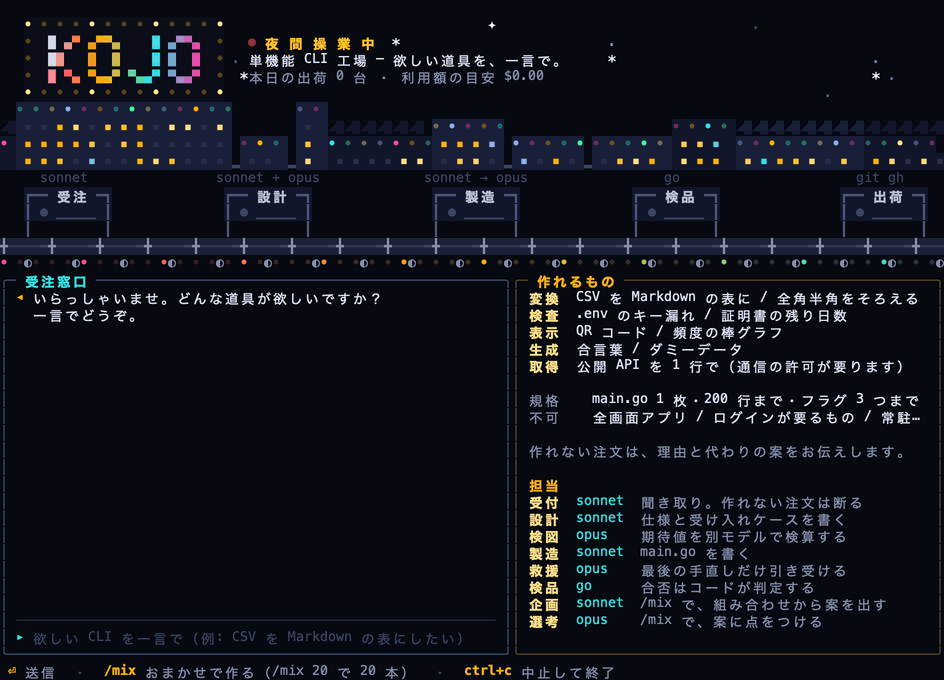
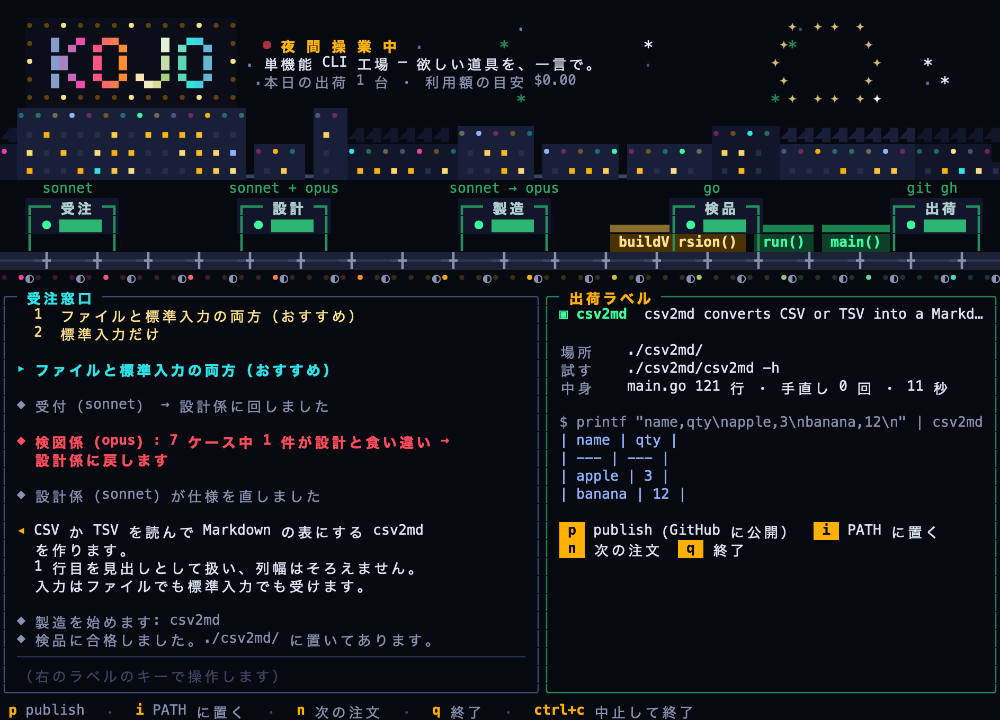
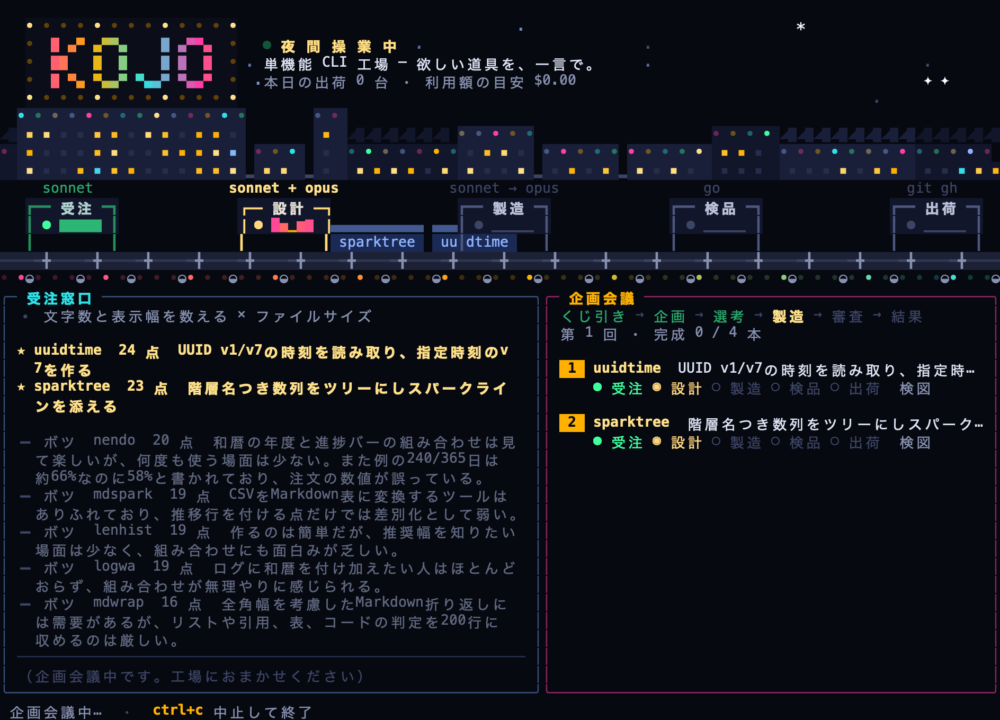
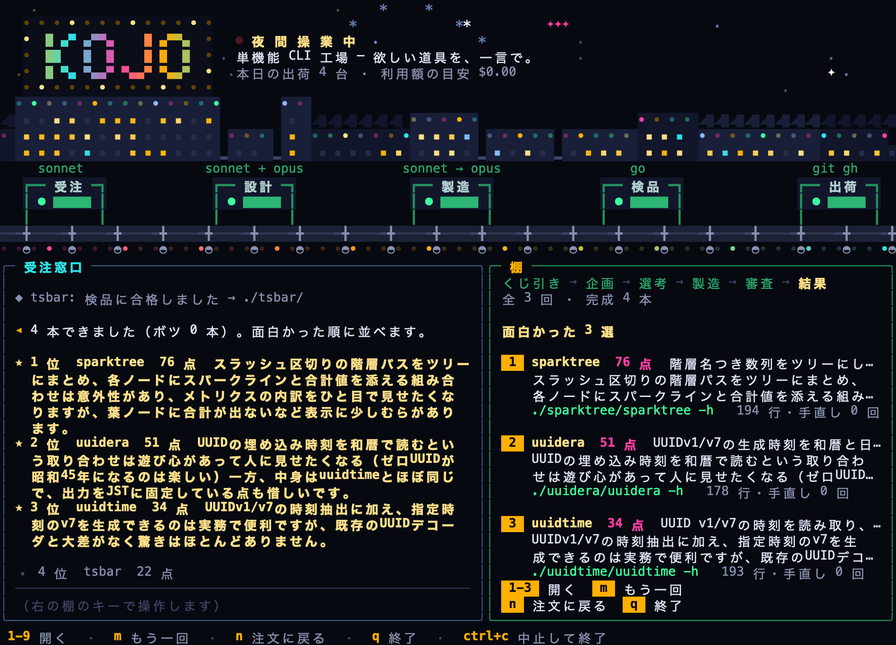

# go-kojo

一言の注文から、単機能のミニマムな Go 製 CLI を作る工場です。
`kojo` を起動して欲しい道具を伝えると、数回のやり取りのあと、その場のサブディレクトリに CLI が出来上がります。画面で publish を選ぶと、GitHub に public リポジトリを作って push します。



注文してから出荷されるまでの画面です（`kojo demo` を録画して早回しにしたもの）。注文票、仕様の項目、書き上がった関数が、箱になってベルトを流れます。

## 必要なもの

- Go 1.27 以降
- [Claude Code](https://claude.com/claude-code) の CLI（`claude`）。ログイン済みであること
- [GitHub CLI](https://cli.github.com/)（`gh`）。publish するときだけ使います

## 使い方

```
go build -o kojo ./cmd/kojo    # このリポジトリの直下で

./kojo          # 工場を開く。カレントディレクトリの下に製品ができます
./kojo demo     # 台本どおりの注文を流して画面を眺める。モデルは呼びません
```

画面は 80×22 以上の端末で動きます。36 行以上あると夜景がすべて表示されます。
tmux の中などで色が 256 色に落ちる場合は `KOJO_COLOR=truecolor kojo` で上書きできます。



検品に合格すると、右の出荷ラベルに、できた CLI を実際に動かした結果が出ます。ここから `p` で publish、`i` で PATH に置けます。左は受付とのやり取りで、検図係の検算が設計と 1 件食い違い、設計係に差し戻した記録が残っています（`kojo demo` の画面なので、やり取りは台本どおりです）。

対話なしで使うこともできます。

```
kojo build -spec evals/specs/csv2md.json        # 仕様ファイルから 1 本作る
kojo eval  -spec evals/specs/csv2md.json,evals/specs/gqr.json -out /tmp/kojo-eval -n 5
```

## 企画会議（おまかせで作る）

注文がなくても、工場が自分でネタを出して作ります。

```
./kojo mix              # 3 本作る
./kojo mix -n 20        # 20 本できるまで回を重ね、最後に面白かった 3 本を選ぶ
./kojo mix QRコード     # 元ネタを指定する
./kojo demo mix         # 実際に流した回の録画を再生する。モデルは呼びません
```

画面の入力欄で `/mix`、`/mix 20`、`/mix QRコード` と打っても始まります。`-plain` を付けると画面を開かずに経過を出力します。

1. **くじ引き**: 元ネタ（棚の製品と定番の道具）に、無関係な素材をくじで 10 組かけ合わせます。斬新さをモデルに頼むとありがちな案に寄るので、組み合わせは乱数で決めます。
2. **企画**: 企画係（Sonnet）が組ごとに案を書きます。筋の通らない組は見送ります。
3. **選考**: 選考係（Opus）が「面白い・作れる・使う・新しい」で採点し、理由を一言添えます。どれを作るかは点数からコードが決めます。
4. **製造**: 上位の案を、ふだんの注文と同じラインに無人で並行して流します。検品に落ちたものは棚に残しません。
5. **次の回**: できた製品は棚に入り、次の回の元ネタになります。
6. **審査**: 目標の本数に達したら、審査係（Opus）が完成品の README（実際の出力つき）を見比べて順位をつけます。



左に採用した案とボツにした案（点数と理由つき）、右に製造中の製品の進み具合が出ます。採用された 2 本が、同じベルトを並んで流れています。



目標の本数ができると、審査係の講評つきで「面白かった 3 選」が棚に並びます。番号キーで製品を開くと、そこから publish できます。
2 枚とも `kojo demo mix` の画面で、下の「4 本の回」の記録を再生したものです。

実際に流した結果です（2026-11-26）。

- 3 本の回: 2 本が合格、1 本はモデル呼び出しの失敗で中止。$0.65。
- 4 本の回: 3 回かけて 4 本が合格。約 10 分、$2.00。1 位は `sparktree`（階層つきの数列をツリーにしてスパークラインを添える）。
- 選考で「新しい」が 5 点中 1 点だった案（`uuidera`）が、完成後の審査では 2 位でした。案の段階の点数は完成品の評価をあまり予測できていないので、作れる案（「作れる」3 以上）は足切りせず作っています。
- そのあと企画会議で作った 20 本は、下の一覧のとおりこのリポジトリに入っています。

## 工場が作ったもの

このリポジトリの直下で工場を動かしてできた製品です（2026-11-26）。検品に落ちたものは残らないので、どれも build、vet、受け入れケースの実機実行、go test に合格しています。それぞれのディレクトリで `go build` すると使えます。依頼文、仕様、受け入れケースは各ディレクトリの `kojo.json` にあります。

企画会議が作った 20 本です。

| 製品 | 種類 | 企画の一言 | main.go の行数 |
|---|---|---|---|
| [`alignre`](alignre/) | 変換 | 正規表現の一致位置が縦に揃うよう各行を空白で整列する | 148 |
| [`b64col`](b64col/) | 変換 | CSVの指定列のBase64セルを復号してCSVで出力する | 141 |
| [`colhash`](colhash/) | 検査 | 2つのCSVの列ごとのハッシュを比べ変化した列を示す | 169 |
| [`csvcheck`](csvcheck/) | 検査 | CSVの列数ずれ・重複行・前後空白を検査して報告する | 171 |
| [`csvwrap`](csvwrap/) | 変換 | CSVを端末幅に収まる折り返し付き表で表示する | 193 |
| [`envchk`](envchk/) | 検査 | .envの重複キー・全角文字・末尾空白を報告する | 166 |
| [`epochwa`](epochwa/) | 変換 | 文中のUNIX時刻を和暦の日時の注釈付きで書き直す | 173 |
| [`hashart`](hashart/) | 表示 | ファイルのハッシュを色付きの視覚指紋として表示する | 163 |
| [`ipfold`](ipfold/) | 変換 | テキスト中のIPv4を/24ごとにまとめ指定幅で折り返して一覧にする | 179 |
| [`jsonmd`](jsonmd/) | 変換 | JSON配列をMarkdownの表に変換する | 195 |
| [`jspark`](jspark/) | 変換 | JSONの数値フィールドをスパークラインにする | 196 |
| [`mdbar`](mdbar/) | 変換 | CSVをMarkdown表にし、数値列を横棒にして添える | 190 |
| [`mdid`](mdid/) | 変換 | CSVに行内容由来の固定UUIDを付けMarkdown表にする | 144 |
| [`nengochk`](nengochk/) | 検査 | 文書内の和暦と西暦の併記が合っているか検査する | 182 |
| [`u4scan`](u4scan/) | 検査 | CSVやテキスト中の絵文字など4バイト文字を位置付きで報告 | 154 |
| [`urlsnag`](urlsnag/) | 検査 | 文章中のURLの全角文字・空白・末尾の句読点混入を検出する | 200 |
| [`wrapal`](wrapal/) | 変換 | 全角幅を考慮して折り返し、左右中央・均等に揃える | 198 |
| [`yenfmt`](yenfmt/) | 変換 | 文章中の金額表記を指定の書式に統一する | 192 |
| [`youbichk`](youbichk/) | 検査 | 文中の日付と曜日の食い違いを見つけて報告する | 167 |
| [`zenhan`](zenhan/) | 変換 | 全角英数と半角カナの表記ゆれを統一して出力する | 177 |

画面から注文して作った 2 本です。「注文」は入力した依頼文そのままです。

| 製品 | 種類 | 注文 | main.go の行数 |
|---|---|---|---|
| [`rainbowqr`](rainbowqr/) | 表示 | 文字を入力したらレインボーなQRコードが派手なアニメーションとともに表示される | 200 |
| [`sl`](sl/) | 表示 | slコマンド、SLのアスキーアートが発信するだけのもの | 80 |

## 作れるもの

`main.go` 1 枚・200 行まで・フラグ 3 つまで・依存 3 つまで（許可リスト内）の CLI です。
変換、検査、生成、表示、公開 API の取得が対象で、全画面アプリ、ログインや API キーが要るもの、常駐するものは作りません。作れない注文は、理由と代わりの案を返します。

## 仕組み

1. **受注**: 受付が不足点だけを質問します。聞き取れたら設計係が仕様 1 枚（振る舞いと受け入れケース）にまとめ、検図係が期待値を検算します。
2. **設計**: 仕様を見て、Enter で承認します。直したい点は書いて送ります。
3. **製造**: リポジトリの骨格はテンプレートから出し、モデルには `main.go` 1 枚だけを書かせます。どの担当のモデルにもツールは渡しません。
4. **検品**: import、行数、gofmt、依存、build、vet、受け入れケースの実機実行、go test を Go のコードで確かめます。不合格なら理由を添えて 2 回まで手直しさせ、それでも落ちたら出荷しません。
5. **出荷**: README を実際の出力から作り、`./<名前>/` に置きます。publish は確認のあと `gh repo create --public --push` を実行します。

製品の `kojo.json` には、依頼文、仕様、受け入れケースが残ります。

## 担当とモデル

担当は 5 つに分かれ、2 つのモデルが受け持ちます。量を書く仕事と会話は Sonnet、少量で難しい判断は Opus です。

| 担当 | 既定のモデル | 仕事 | そのモデルにした理由 |
|---|---|---|---|
| 受付 | claude-sonnet-5-5 | 聞き取り。質問するか、断るか、設計に回すかを決める | 測ると Haiku より速かった（平均 4 秒と 8 秒） |
| 設計 | claude-sonnet-5-5 | 仕様 1 枚と受け入れケースを書く | 出力が長い |
| 検図 | claude-opus-5-5 | 期待値を見せずに各ケースの結果を導き直す | 出力は短いが、推論が難しい。設計と別のモデルにして見落としを変える |
| 製造 | claude-sonnet-5-5 | `main.go` を書き、手直しする | 計測で Opus と合格率に差がなく、2.5 倍速かった |
| 救援 | claude-opus-5-5 | 最後の手直しだけ引き受ける | 2 回直せなかったものにだけ上位モデルを使う |
| 検品 | なし（Go のコード） | 合否の判定 | モデルに自分の仕事を採点させない |

検図の結果と設計の期待値は、モデルに聞かずコードで突き合わせます。食い違ったケースだけ、検図の導いた結果を添えて設計に戻し、仕様を直させます。どの担当もツールは持たず、決まった形の JSON を返すだけです。

`-reception` `-design` `-review` `-build` `-rescue` で差し替えられます（`-review none` で検図なし）。

## 計測

手書きの仕様 2 本を 5 回ずつ作らせた結果です（2026-11-26、`kojo eval`）。gqr は出力を QR コードとして復号できることまで確かめています。

| 仕様 | モデル | 合格 | 手直しなし | 平均時間 | 平均費用の目安 |
|---|---|---|---|---|---|
| csv2md | claude-sonnet-5-5 | 5/5 | 5/5 | 12 秒 | $0.02 |
| csv2md | claude-opus-5-5 | 5/5 | 5/5 | 32 秒 | $0.09 |
| gqr | claude-sonnet-5-5 | 5/5 | 5/5 | 12 秒 | $0.02 |
| gqr | claude-opus-5-5 | 5/5 | 5/5 | 28 秒 | $0.08 |

費用は CLI が報告する定価換算の推定値です。

### 注文から製品まで

`evals/orders.txt` の注文 6 件を、言葉から製品まで通しました（`kojo eval -orders`）。期待値を間違えやすい注文を選んでいます。

| 体制 | 出荷 | 手直しなし | 平均費用の目安 | 平均時間 |
|---|---|---|---|---|
| 単独（すべて Sonnet、検図と救援なし） | 6/6 | 6/6 | $0.14 | 50 秒 |
| 分担（検図と救援あり） | 6/6 | 6/6 | $0.15 | 65 秒 |

- 合格率に差は出ませんでした。検図と救援は、この 6 件では「なくても通った」保険です。
- 検図は 6 件で 45 ケースを検算し、食い違いは 1 件でした（時間を取るために流し直した 2 件では、16 ケースで 0 件）。その 1 件が設計の誤りだったのかは、記録を取っておらず分かっていません（以後は `orders.jsonl` に残ります）。
- 検図の追加分は、1 件あたり約 12 秒と $0.04 です。
- 平均時間は別に流した 2 件の値です。6 件の回は、実装の不具合で時間が記録されていませんでした。
- この計測の分担体制は受付が Haiku でした。受付だけを 4 件で測ると Haiku は平均 8 秒、Sonnet は 4 秒で、判断は同じだったので、既定を Sonnet に変えています。

## 注意

- モデルが書いたプログラムを、サンドボックスなしで手元でコンパイル・実行します。
- publish すると `kojo.json` の依頼文も公開されます。
